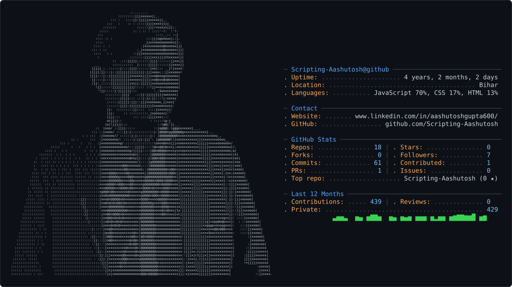

<h1 align="center">Hey  I'm Aashutosh Gupta</h1>

<picture>
  <source media="(prefers-color-scheme: dark)" srcset="dark_mode.svg" />
  <source media="(prefers-color-scheme: dark)" srcset="light_mode (1).svg" />
  
</picture>

## 📌 About Me
**A passionate Frontend Developer || Web Developer and Design ||  Currently Learning Backend**

Email Me 👉 ✉️ **aashutoshgupta600@gmail.com** For Collaboration/Project or Anything Else. 😊😊

- 🔭 **I’m currently working on:** Freelancing Project
- 🌱 **I’m currently learning:** Backend Development
- 👯 **I’m looking to collaborate on:** Enter your project name and info
- 🤔 **I’m looking for help with:** Your project here
- 💬 **Ask me about:** Collaboration, Tech Support
- 📫 **How to reach me:** aashutoshgupta600@gmail.com
- 😄 **Pronouns:** Aashu
- ⚡ **Fun fact:** I Love Tech and Tech Love Me

<!-- ================= TECH STACK BENTO GRID ================= -->

<h2 align="center">💻 Tech Stack & Technologies</h2>

  <em>My developer toolkit — technologies I use to build modern applications.</em>

<table width="100%" align="center">
<tr>
<td width="50%" valign="top">

<h3>⚡ Programming Languages</h3>

</td>
<td width="50%" valign="top">

<h3>🎨 Frontend Development</h3>

</td>
</tr>

<tr>
<td width="50%" valign="top">

<h3>⚙️ Backend Development</h3>

 

</td>
<td width="50%" valign="top">

<h3>🗄️ Database & ORM</h3>

</td>
</tr>

<tr>
<td width="50%" valign="top">

<h3>🧩 Libraries & Frameworks</h3>

</td>
<td width="50%" valign="top">

<h3>🛠️ Tools & Deployment</h3>

</td>
</tr>
</table>

  

  ⚡ Always exploring new technologies and building better things.

<!-- ================= END TECH STACK ================= -->

# 📊 GitHub Stats

## 🏆 `> unlock --achievements`

### ✍️ Random Dev Quote

<picture>
  <source media="(prefers-color-scheme: dark)" srcset="https://www.gitskins.com/api/section/heatmap?username=scripting-aashutosh&theme=github-dark&mode=dark" />
  <source media="(prefers-color-scheme: light)" srcset="https://www.gitskins.com/api/section/heatmap?username=scripting-aashutosh&theme=github-dark&mode=dark" />
  
</picture>

## 🔗 Connect with Me
---

  

<h2 align="center">🤝 Let's Create Something Meaningful</h2>

  I'm always open to connecting with developers, collaborating on exciting projects, and exploring new opportunities.

  <strong>💼 Open to Opportunities &nbsp; | &nbsp; 🚀 Collaboration &nbsp; | &nbsp; 💡 Ideas</strong>

  
  
  

  <em>"Great things are built when creativity meets code."</em>

  © 2026 Aashutosh Gupta · Crafted with ❤️ and Code

  

  <!---->

